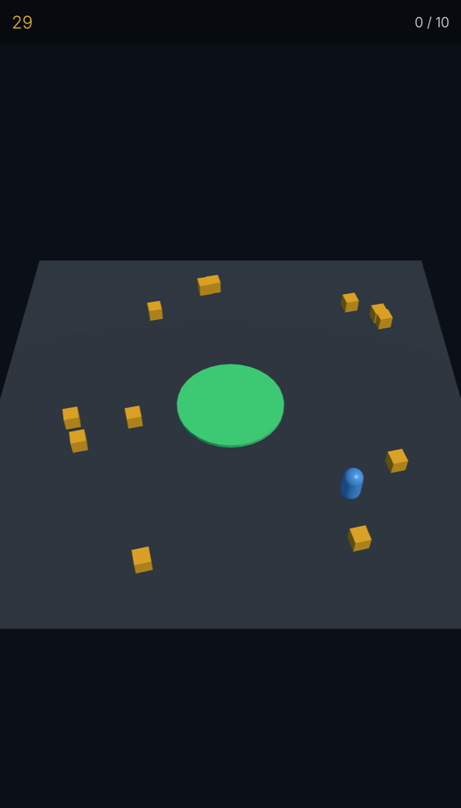

# SceNoCo

**Scene · Node · Component** — Unity's component model on [Three.js](https://threejs.org), in
three layers you take one at a time.

| | you get | it costs you |
| --- | --- | --- |
| **1. `@scenoco-three/core`** | `Component`, `System`, prefabs, scenes, input, coroutines on plain three.js objects. 3k lines, one dependency. | learning `awake` / `start` / `update`, and nothing else — no build step, no format |
| **2. `@scenoco-three/compiler`** | scenes as documents, compiled to TypeScript and **checked**: a bad `#id` is a build error with a file and line; `scenoco describe` answers what anything accepts | a document format, and a Vite plugin |
| **3. `@scenoco-three/observer`** | an MCP server over stdio that runs the scene in a headless Chrome it owns — `outline`, `screenshot`, `simulate`, `eval`, `telemetry` — so an agent can drive the running game and read it back as text | `claude mcp add scenoco -- npx -y @scenoco-three/observer` |
| **`@scenoco-three/editor`** | a standalone visual editor: a static site that opens any scene from a folder or a URL, with a tree, an inspector, gizmos and saves | a browser |

Start at 1. Every layer works without the one above it, and the one above never changes what the
one below means. Everything three.js already does — rendering, and through thin adapters physics
(Rapier, planck), UI (uikit), particles (three.quarks) — stays three.js's; nothing here is an
engine.

## Layer 1: components on three.js

```ts
import { Component, SceneManager } from '@scenoco-three/core';
import { Mesh, Scene } from 'three';

class Spinner extends Component {
  speed = 1;                                          // a public field is a setting
  override update(dt: number) { this.object3D.rotation.y += this.speed * dt; }
}

class Level extends Scene {
  override onLoad() { this.createObject('cube').addComponent(Spinner, { speed: 2 }); }
}

await SceneManager.load(Level);
```

`this.object3D` is the `THREE.Mesh` — there is no wrapper. Extending `Component` is the whole
registration. That is the entire layer; if you never want a document, stop here.

## Layer 2: a scene is a document, and it is checked

A document is **compiled at build time into a TypeScript module beside it**. So the browser gets
ordinary typed code — `tsc` checks every reference in it, a bad `#id` is a type error with a
real file and line, and no XML, parser or registry ships to the browser at all.

```xml
<!-- assets/scenes/level-1.scene.xml -->
<Scene camera="#camera" background="#05070d" render="../render/neon.render.xml">
  <Systems>
    <Physics2D gravity="x: 0; y: 0" />
  </Systems>

  <PerspectiveCamera id="camera" position="y: 8.5; z: 24">
    <Components>
      <CameraFit mode="contain" width="21" height="19.5" distance="24" />
    </Components>
  </PerspectiveCamera>

  <Mesh id="paddle" geometry="../geometry/paddle.asset.xml"
        material="../materials/paddle.asset.xml" position="y: 1">
    <Components>
      <Paddle speed="16" halfRange="7.4" />
      <RigidBody2D kind="kinematic" />
      <BoxCollider2D halfExtents="x: 1.6; y: 0.225" restitution="1" />
    </Components>
  </Mesh>

  <Prefab src="brick.prefab.xml" position="x: -2.55; y: 13.9">
    <Override target="#brick" hits="2" />
  </Prefab>
</Scene>
```

```ts
import { Component } from '@scenoco-three/core';

/** Moves the paddle. A public field is an attribute; extending Component is the registration. */
export class Paddle extends Component {
  speed = 16;
  halfRange = 7.4;

  override update(dt: number): void {
    this.object3D.position.x += this.speed * dt; // this.object3D IS a THREE.Object3D
  }
}
```

There is no decorator, no registry and nothing to import for a component to exist. The build
finds it by reading your workspace with the TypeScript checker, and its attributes *are* its
public fields — so the document format cannot drift from the code, because there is no second
copy of the truth anywhere.

## Layer 3: an agent can see it run

The observer is an MCP server. It compiles the project, launches Chrome headless, opens the scene
in it, and answers from that page: `open` a document, `outline` it as text — every node with its
id, position and components — `screenshot` it from a stated viewpoint, `simulate` it (pause, step
exact frames, press keys) and read `telemetry` back by id. Its `eval` step runs JavaScript against
the running scene, so "put a slime in front of the player, fire, read the score" is three steps
rather than a hunt. It speaks stdio, so the setup is one line, and nothing appears on screen.

The visual editor is a separate, standalone thing: a static site that opens any scene from a
folder or a URL and edits it in place, hosted on GitHub Pages.

## Why

- **Familiar by design.** Tags and attributes mirror three.js verbatim (`<BoxGeometry width>`,
  `<MeshStandardMaterial roughness>`), because the vocabulary is read from three's own
  declarations — a three.js upgrade that adds a parameter adds an attribute for free. The
  component API mirrors Unity (`getComponent`, `awake`/`start`/`update`, `enabled`, `destroy`,
  `dontDestroyOnLoad`). If you know three.js and a component engine, you know this.
- **The output is code you can read.** A scene compiles to a class whose `onLoad` constructs the
  tree — no bundle, no decoder, no reflection. Land in it from a stack trace and you can see
  what the XML said.
- **The compiler is the check.** `file:line:col` diagnostics with the exact text to write
  instead: a misspelt component names the nearest real one, `color="tomato"` answers with the
  hex, a positional vector answers with the keyed form. One pass reports everything.
- **One spelling per value.** Keyed axes, `#rrggbb`, degrees. Where a second spelling is
  plausible the compiler reads it and rejects it *with the answer*, so there is nothing to
  choose between while authoring.
- **Import no physics, ship no physics.** Physics, UI, particles, audio and post-processing are
  separate packages on public seams. Core is `three`-peer-only and knows about none of them.

## Packages

| Layer | Package | What it is |
| --- | --- | --- |
| 1 | [`@scenoco-three/core`](packages/core) | Runtime: `Component`, `System`, `SceneManager`, `Engine`, the `Object3D`/`Scene` augmentations, input, coroutines, assets. |
| 2 | [`@scenoco-three/compiler`](packages/compiler) | Build time: the parser, the workspace scan, the emitters, diagnostics, `scenoco check` / `describe` / `init`. Run `describe` for the format. |
| 2 | [`@scenoco-three/vite`](packages/vite) | The Vite plugin: compile on start, recompile on change. ~120 lines. |
| 3 | [`@scenoco-three/observer`](packages/observer) | The MCP server, over stdio, driving a headless Chrome: `open`, `outline`, `screenshot`, `telemetry`, `simulate` with `eval`. |
| — | [`@scenoco-three/editor`](packages/editor) | The standalone visual editor: a static site (GitHub Pages, or `npx scenoco-editor`) that opens a scene from a folder or a URL. Depends on nothing at run time. |
| adapters | | thin, opt-in, 50 to 400 lines each: |
| | [`@scenoco-three/box2d`](packages/box2d) | 2D physics (planck): `<Physics2D>`, `<RigidBody2D>`, `<*Collider2D>`, Unity-style contact hooks. |
| | [`@scenoco-three/rapier`](packages/rapier) | 3D physics (Rapier), same shapes. |
| | [`@scenoco-three/collision`](packages/collision) | Detection only, with rapier's exact tags — swap one import to switch. Zero deps. |
| | [`@scenoco-three/ui`](packages/ui) | In-canvas UI on pmndrs uikit: `<Canvas>`, `<Panel>`, `<Text>`, `<Image>`, placed the way Unity's RectTransform places things. |
| | [`@scenoco-three/particles`](packages/particles) | Unity-Shuriken-shaped particles on three.quarks. It declares the `.particle.xml` document kind itself — see [MODULES.md](MODULES.md). |
| | [`@scenoco-three/audio`](packages/audio) | `<AudioSource>`, 2D and positional. |
| | [`@scenoco-three/postfx`](packages/postfx) | Render settings: `<ToneMapping>`, `<Shadows>`, `<Bloom>`, `<Vignette>` — the tags a `.render.xml` holds. |

## The document kinds

`*.scene.xml` · `*.prefab.xml` · `*.render.xml` · `*.asset.xml` · `*.texture.xml`, **plus whatever
the installed packages declare** — `*.particle.xml` comes from `@scenoco-three/particles`, not from
the compiler. Each compiles to a `.gen.ts` beside it (a build artifact — gitignore it). A prefab
exports `XPrefab`, a scene exports `XScene`; every other kind exports one shared value.

`scenoco new` lists the kinds this project can create and writes a starter that compiles. To add
one of your own, see [MODULES.md](MODULES.md).

## Examples

| | |
| --- | --- |
| [**Breakout**](examples/breakout) — three levels, Box2D, in-canvas HUD, bloom | [**Collector**](examples/collector) — thumb-stick movement, a carried stack, a depot |
| [](examples/breakout) | [](examples/collector) |

[**Playable**](examples/playable) is the smallest of them — one mechanic, twenty seconds, no menu.
[**Castle**](examples/castle) is deliberately empty: a lit stage with the primitive shapes and
nothing built, for trying something out.

## Start a project

```bash
npx @scenoco-three/compiler init my-game
cd my-game && npm install && npm run dev
```

A block you steer with the arrow keys, crates you drop with Space, a camera that follows — a scene,
a prefab, four components of a dozen lines each that between them use every verb a component has,
and an `AGENTS.md` that says the whole model in a page. The starter is not broken on purpose; it
ends with one thing to try that shows what the compiler does when you slip.

## Quick start (this repo)

```bash
npm install
npm run examples:dev   # examples/breakout — three levels, Box2D, in-canvas HUD, bloom
npm test               # vitest — zone folders under tests/{core,compiler,packages,tooling}
npm run build          # every package, in dependency order
npm run typecheck      # cross-package tsc --noEmit
```

Working *on* this repo with an agent? Start at [`AGENTS.md`](AGENTS.md).

## Documentation

- `npx scenoco describe` — the vocabulary and the project, read off the source so it cannot go
  stale. Name anything for its detail: `describe Component`, `describe Input`, `describe Mesh`.
- `packages/*/README.md` — each package documents its own surface.
- The doc comments in `packages/core/src/index.ts` are the tour of the API.

## Status

Pre-1.0; the surface still moves.

## License

[MIT](LICENSE)
