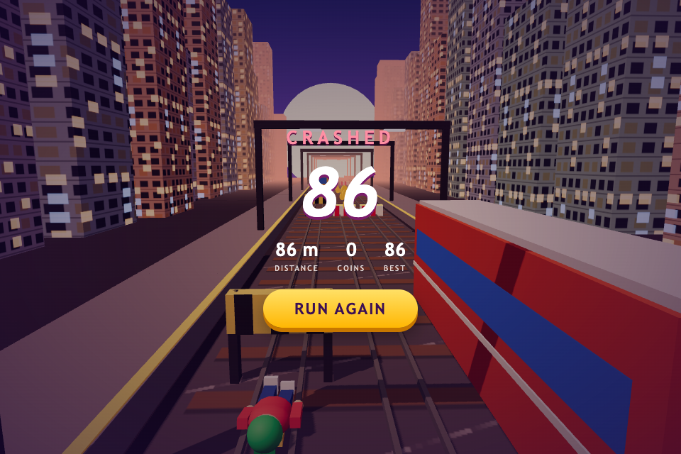

# SceNoCo

**Scene · Node · Component** — Unity's behaviours on [three.js](https://threejs.org), with scenes
written in TSX and no React.

```tsx
// game/Spinner.ts — a behaviour: Unity's lifecycle, public fields are its settings
export class Spinner extends Behaviour<Mesh> {
  speed = 1;
  update(dt: number) {
    this.node.rotation.y += this.speed * dt;
  }
}
```

```tsx
// game/Main.tsx — a scene: every tag is the three.js class you import, built at once
export const Main = () => (
  <Scene>
    <PerspectiveCamera position={[0, 2, 5]} />
    <DirectionalLight position={[3, 8, 5]} intensity={2} />
    <Mesh>
      <BoxGeometry />
      <MeshStandardMaterial color="orange" />
      <Spinner speed={2} />
    </Mesh>
  </Scene>
);
```

```ts
// main.ts
play(Main);
```

That is the whole model:

- **A tag is a class you import** and `<Mesh>` is `new Mesh()`. Attributes follow React Three
  Fiber's rules — `args` are constructor arguments, `position={[0, 1, 2]}` goes through the
  property's own `set`, `shadow-mapSize` reaches inside, geometry and material attach to their
  parent. There is no React and no reconciler: TSX builds the objects once.
- **A `Behaviour` is a component**, with Unity's hooks (`awake`, `start`, `update`, `fixedUpdate`,
  `onDestroy`, …), coroutines, `Time`, `Input`, `instantiate`, `destroy`, `findObjectOfType`,
  `SceneManager`.
- **A prefab is a function** returning TSX; `instantiate(Prefab)` calls it.
- **A scene only declares.** Logic lives in behaviours. `scenoco check` refuses loops, branches and
  calls in a `.tsx` file and says what to write instead — which is what keeps a scene editable by a
  tool as well as by hand.
- Everything else is three.js, as three.js documents it — the renderer, post-processing, loaders.

`tsc` checks all of it: a misspelled attribute, a wrong value type, a lowercase tag and a ref of the
wrong class are type errors at the line they were written on.

## Start a project

```bash
npm create @scenoco-three my-game
cd my-game && npm install && npm run dev
```

A block you steer, crates you drop, a camera that follows — every verb a behaviour has, in four short
files — and an `AGENTS.md` that says the whole model in a page, with the observer already in
`.mcp.json` for an agent to look at the running game.

## Packages

| | |
| --- | --- |
| [`@scenoco-three/core`](packages/core) | `Behaviour`, the TSX runtime, `play`, `SceneManager`, `Time`, `Input`, coroutines, events, asset loading. [Its whole API on one page.](packages/core/API.md) |
| [`@scenoco-three/rapier`](packages/rapier) | 3D physics on Rapier, in Unity's shape: `Rigidbody`, `BoxCollider`, `onTriggerEnter`. |
| [`@scenoco-three/box2d`](packages/box2d) | 2D physics on planck: `Rigidbody2D`, `BoxCollider2D`, `onCollisionEnter2D`. |
| [`@scenoco-three/particles`](packages/particles) | Unity's `ParticleSystem` on three.quarks. |
| [`@scenoco-three/audio`](packages/audio) | Unity's `AudioSource` on three.js's Web Audio. |
| [`@scenoco-three/tools`](packages/tools) | `scenoco check` — a scene only declares — and the read/edit layer an editor uses on scene files. |
| [`@scenoco-three/create`](packages/create) | The starter `npm create @scenoco-three` copies. |
| [`@scenoco-three/editor`](packages/editor) | A visual editor that runs on the game's own dev server (`?edit`) and writes edits back into the `.tsx` files byte for byte. |
| [`@scenoco-three/observer`](packages/observer) | An MCP server that runs the game in a headless Chrome and lets an agent hold its clock, drive it and read its behaviours back as text. |

## Editing a scene by hand, visually

```bash
npm run dev            # the game, as always
npx scenoco-editor     # then open the game with ?edit
```

The game's own code builds the scene and holds it still; a tree, an inspector and gizmos edit it,
and each change is written into the `.tsx` file it came from, one attribute at a time, everything
else byte for byte. See [`packages/editor`](packages/editor).

## Examples

[**Breakout**](examples/breakout) — three levels, Box2D, an HTML HUD, bloom.

[](examples/breakout)

[**Rail Rush**](examples/subway) — a Subway Surfers clone written by Claude Sonnet in one session on
a fresh starter: 5 minutes, $0.84.

[](examples/subway)

## This repo

```bash
npm install
npm run build          # every package, in dependency order
npm run examples:dev   # examples/breakout
npm test               # vitest, under tests/{core,packages,tooling}
npm run typecheck      # tsc over every package and the tests, then breakout's own check
```

Working *on* this repo with an agent? Start at [`AGENTS.md`](AGENTS.md). Where it is going:
[`CUT-PLAN.md`](CUT-PLAN.md).

## Status

Pre-1.0, mid-redesign: scenes moved from XML documents to TSX in 0.7, and the editor was rebuilt
on them.

## License

[MIT](LICENSE)
